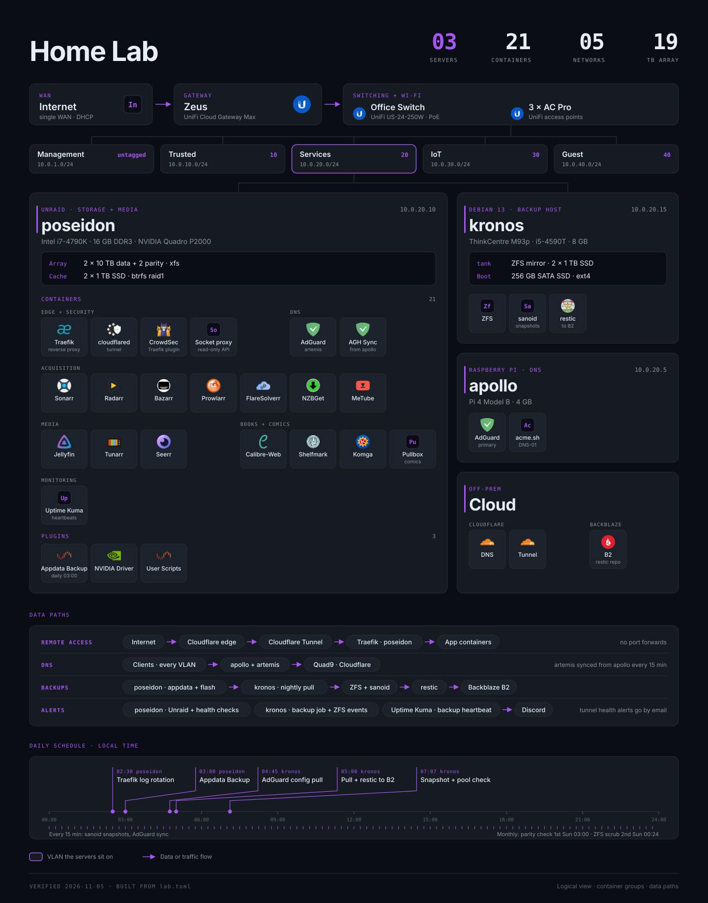
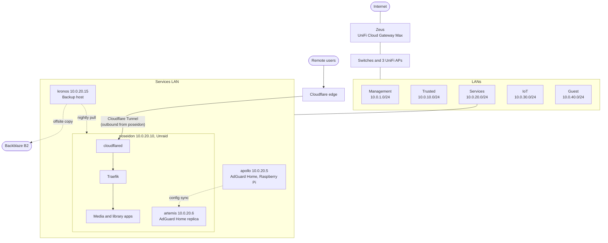

# homelab

This is the documentation for my home lab. It runs my media and book
libraries, filtered DNS for the home network, and a few small apps. The docs
here cover how it is built, how I run it, and what I found and fixed when I
audited it.

The facts in these docs were observed on the live systems during the audit or
re-checked after a change. Where something was reported by me rather than
observed, the doc says so. [METHODOLOGY.md](METHODOLOGY.md) explains how.

## Hardware

| System | Role | Hardware |
|---|---|---|
| poseidon | Unraid server: storage, media, reverse proxy, tunnel, second DNS resolver | Intel Core i7-4790K, 16 GB DDR3, ASUS Z97-A, NVIDIA Quadro P2000. 4 x 10 TB HDD (2 parity, 2 data), 2 x 1 TB SSD cache mirror |
| apollo | Primary DNS resolver (AdGuard Home) | Raspberry Pi 4 Model B, 4 GB |
| kronos | Backup host: pulls poseidon's backups, keeps snapshots, sends a copy offsite | Lenovo ThinkCentre M93p, Intel Core i5-4590T, 8 GB. 2 x 1 TB SSD ZFS mirror |
| Zeus | Gateway and firewall | UniFi Cloud Gateway Max |
| Switching | Core switch | UniFi US-24-250W (24 port, PoE) |
| Wi-Fi | Access points | 3 x UniFi AC Pro |

## Topology

- The gateway has no inbound port forwards. Remote access to web apps goes
  through a Cloudflare Tunnel, which cloudflared opens outbound from poseidon.
  Traefik then routes each request by hostname to a container.
- DHCP on every LAN hands out both AdGuard resolvers, apollo and artemis.
  artemis runs as a container on poseidon with its own LAN address, and a sync
  container keeps its config in step with apollo.

## Services

| Role | Services |
|---|---|
| Storage | Unraid array with dual parity, btrfs cache mirror |
| Edge and reverse proxy | Cloudflare Tunnel (cloudflared), Traefik with the CrowdSec plugin, CrowdSec, Docker socket proxy |
| DNS | AdGuard Home on apollo and on poseidon (artemis), adguardhome-sync |
| Media servers | Jellyfin, Tunarr, Komga, Calibre-Web Automated |
| Library management | Sonarr, Radarr, Bazarr, Prowlarr, Pullbox, Shelfmark, FlareSolverr |
| Requests | Seerr |
| Downloads | NZBGet (usenet only), MeTube |
| Backup | Appdata Backup plugin on poseidon, nightly pull to a separate backup host (kronos) |
| Monitoring | Scheduled scripts on poseidon that post alerts to Discord, Uptime Kuma for the backup heartbeat |

## Docs

- [METHODOLOGY.md](METHODOLOGY.md): how the audit was done
- [diagram/](diagram/README.md): the lab diagram and the script that builds it
- poseidon: [current state](systems/poseidon.md), [audit findings](findings/poseidon.md)
- network: [current state](systems/network.md), [audit findings](findings/network.md)
- adguard: [current state](systems/adguard.md), [audit findings](findings/adguard.md)
- cloudflare: [current state](systems/cloudflare.md), [audit findings](findings/cloudflare.md)
- kronos: [current state](systems/kronos.md), [audit findings](findings/kronos.md)
- arr (Sonarr, Radarr, Prowlarr, Pullbox): [current state](systems/arr.md), [audit findings](findings/arr.md)
- [runbooks/](runbooks/README.md): procedures for disk, flash, restore, DNS, network and Cloudflare tasks

Design decisions:

- [0001: Cloudflare Tunnel instead of port forwards](decisions/0001-cloudflare-tunnel.md)
- [0002: Dual parity](decisions/0002-dual-parity.md)
- [0003: Unraid as the server OS](decisions/0003-unraid.md)
- [0004: One /data tree for downloads and media](decisions/0004-single-data-tree.md)
- [0005: btrfs raid1 cache pool](decisions/0005-cache-pool.md)
- [0006: Cloudflare Access instead of Tinyauth](decisions/0006-cloudflare-access.md)
- [0007: Second AdGuard Home on poseidon](decisions/0007-second-adguard-on-poseidon.md)
- [0008: Monthly parity checks](decisions/0008-monthly-parity-checks.md)
- [0009: DHCP reservation instead of a static IP](decisions/0009-dhcp-reservation.md)
- [0010: Quadro P2000 for Jellyfin and Tunarr](decisions/0010-quadro-p2000.md)
- [0011: Usenet only, no torrent or debrid client](decisions/0011-usenet-only.md)
- [0012: Pullbox instead of Mylar3 for comics](decisions/0012-pullbox-for-comics.md)
- [0013: Explicit tunnel hostnames instead of a wildcard](decisions/0013-explicit-tunnel-hostnames.md)
- [0014: A socket proxy between Traefik and Docker](decisions/0014-docker-socket-proxy.md)
- [0015: CrowdSec's Traefik plugin instead of a standalone bouncer](decisions/0015-crowdsec-traefik-plugin.md)
