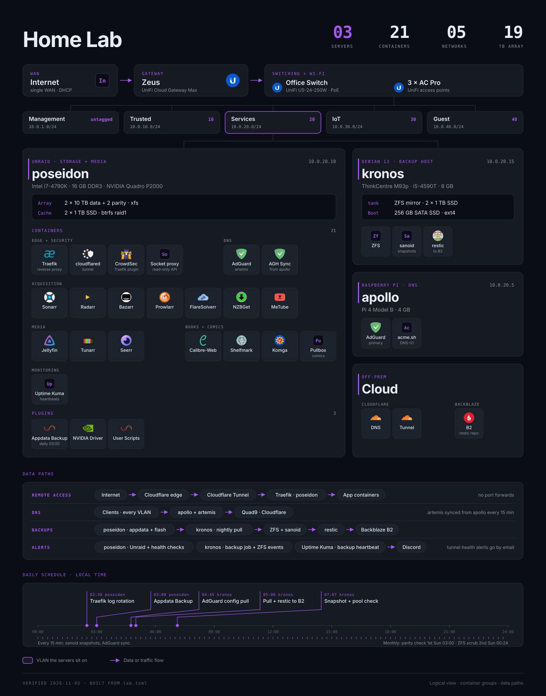

# Lab diagram



`homelab.svg` is a one-page picture of the lab: the WAN and switching, the
five networks, each host with its services, the main data paths and the
daily schedule. It is generated from `lab.toml` by `build.py`, so I update
the diagram by editing data, not by drawing.

## Files

| File | What it is |
|---|---|
| lab.toml | Source data |
| build.py | Generator. Python 3.11 or later, standard library only |
| homelab.svg | Output. Self-contained, with the logos embedded |
| homelab.png | Preview render |
| logos/ | Service logos, one file per icon slug |

## Build it

```bash
python build.py --png
```

`--png` also renders `homelab.png` with headless Chrome or Edge, if one is
installed. The Servers, Containers and Networks counts are computed from
`lab.toml`.

To change the diagram:

- Add a container as a tile in the right group.
- Add a host as a new `[[cards]]` entry. `column = "side"` stacks it on the
  right.
- Add a VLAN as a `[[networks]]` entry.
- Update `verified` in `[meta]`.

A tile uses `logos/<icon>.svg` or `.png`, where `icon` defaults to the tile's
`id`. Without a logo file the tile shows a two-letter monogram, and
`build.py` lists the slugs that have none.

## Logos

The logos come from the [homarr-labs dashboard-icons](https://github.com/homarr-labs/dashboard-icons)
set. Each logo is a trademark of its project or company and is used here
only to identify the software.
