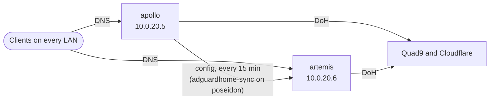

# adguard

Last verified: 2026-11-05

The lab's DNS is two AdGuard Home resolvers that filter ads, trackers and
known-malicious domains for every network. apollo, a Raspberry Pi, is the
primary and the one I configure. artemis, a container on poseidon, is a
replica kept in step with it.

Audit write-ups for DNS are in [findings/adguard.md](../findings/adguard.md).

## Resolvers

| Resolver | Address | Runs on | Role |
|---|---|---|---|
| apollo | 10.0.20.5 | Raspberry Pi 4 Model B, 4 GB | Primary. All changes are made here |
| artemis | 10.0.20.6 | Container on poseidon, macvlan network | Replica, synced from apollo |

Both are on the Services LAN. DHCP on every network hands out both of them
and no public resolver (see [systems/network.md](network.md)).

## apollo host

| Item | Value |
|---|---|
| Hardware | Raspberry Pi 4 Model B, 4 GB RAM, wired at 1 Gbps |
| OS | Raspberry Pi OS, based on Debian 13 |
| Updates | unattended-upgrades runs daily, for the Debian, Debian security and Raspberry Pi repositories |
| AdGuard Home | Installed from the official release, run as a systemd service that restarts on failure |
| Time | NTP, synced |
| Logs | The journal is kept on disk, capped at 200 MB. Raspberry Pi OS keeps it in memory by default, so I override that |
| Power | Official Raspberry Pi power supply, with no undervoltage or throttling logged |

Raspberry Pi kernel packages don't flag that a reboot is needed, so
unattended-upgrades installs new kernels but never reboots for them. I reboot
by hand after a kernel update.

The second resolver's container is described in
[systems/poseidon.md](poseidon.md#second-dns-resolver-artemis), and why it
runs there is in [decision 0007](../decisions/0007-second-adguard-on-poseidon.md).

## Upstreams and resolver settings

| Setting | Value |
|---|---|
| Upstreams | Quad9 (unfiltered) and Cloudflare, both over DNS-over-HTTPS, load balanced |
| Bootstrap | Quad9 and Cloudflare plain DNS addresses, used only to look up the DoH hostnames |
| DNSSEC | On |
| Cache | On, 128 MB, with optimistic caching so an expired answer can be served while it refreshes |
| Rate limit | 32 queries per second per client |
| DHCP server | Off. The gateway does DHCP |

Two upstream providers, with bootstrap addresses from both, mean that one
provider being down does not stop resolution.

## Filtering

| Type | What |
|---|---|
| Blocklists | 9 lists: the AdGuard DNS filter, HaGeZi Pro, HaGeZi Threat Intelligence Feeds, HaGeZi pop-up and native tracker lists, a HaGeZi list of DoH, VPN and proxy bypass services, and OISD Big |
| Custom rules | Block iCloud Private Relay |
| Safe browsing | On |
| List updates | Every 24 hours |

## Local names

| Name | Answer |
|---|---|
| apollo.lan | 10.0.20.5 |
| artemis.lan | 10.0.20.6 |
| poseidon.lan | 10.0.20.10 |
| zeus.lan | 10.0.1.1 |

AdGuard Home is the only place fixed local names are defined. Every network
hands out `lan` as its search domain, so a bare name like `poseidon` resolves
too. For other devices, AdGuard asks the gateway, which knows the name each
DHCP client gave, so reverse lookups return names like `kronos.lan` and the
query log shows device names instead of bare addresses.

The resolver also has
a hostname on my public domain, and a rewrite answers it with apollo's LAN
address. That is what lets LAN clients use encrypted DNS with a trusted
certificate (below).

## Encrypted DNS

apollo serves DNS-over-TLS, DNS-over-QUIC and DNS-over-HTTPS, as well as plain
DNS.

- The certificate is from Let's Encrypt, for the resolver's hostname. acme.sh
  renews it through a DNS-01 challenge, using a Cloudflare API token scoped to
  editing DNS on that one zone (I confirmed the scope in the Cloudflare
  dashboard). Renewal runs daily and replaces the
  certificate when it is due.
- Encrypted DNS is home-only. The hostname resolves to apollo's LAN address
  only through the local rewrite, and nothing forwards DNS ports from the
  internet, so encrypted DNS works only on the LAN.
- artemis serves plain DNS only. TLS settings are not part of the sync.

## Admin UI

- The web UI is served over HTTPS only. Plain HTTP redirects to HTTPS.
- It is reachable from the LAN and the VPN, not from the internet. The
  resolver's hostname has no public DNS record and no route through the
  Cloudflare Tunnel.
- Logins lock out for 15 minutes after 5 failures.

## Sync

adguardhome-sync, a container on poseidon, copies apollo's configuration to
artemis every 15 minutes through each instance's web API.

- It copies upstreams, filtering, rewrites, clients and other DNS settings.
- It does not copy TLS settings, web users or DHCP settings.
- Rewrites and other changes are made on apollo only. The sync overwrites
  artemis's own settings.

## Query log and statistics

| Item | Retention |
|---|---|
| Query log | 7 days |
| Statistics | 7 days |

## Monitoring

A script on poseidon checks both resolvers and the sync every 5 minutes, and
posts to Discord when a problem persists for two runs in a row and again
when it clears. It checks that each resolver answers, still blocks, and
still has the local rewrite for the resolver's hostname. Details are in
[systems/poseidon.md](poseidon.md#monitoring).

## Backup and restore

Every night at 04:45, kronos pulls apollo's AdGuard config and its certificate
files over SSH, with a key that can only run that one export. The copy rides
along in kronos's ZFS snapshots and its offsite copy in Backblaze B2 (see
[systems/kronos.md](kronos.md)).

On 2026-11-05 I restored that copy from a snapshot into a temporary AdGuard
container on poseidon. It loaded the config and certificate, answered
queries, blocked a known tracker, returned the local names, served the
resolver's certificate over HTTPS and required a login. The query log and
statistics are not in the backup, and the filter lists download again on
first start.

