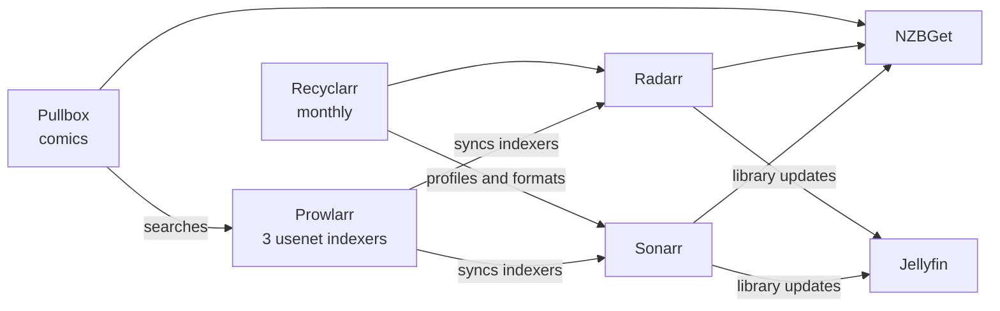

# arr

Last verified: 2026-11-05

The "arr" apps automate the TV and movie libraries on poseidon. Sonarr
handles TV, Radarr handles movies, and Prowlarr manages the indexers for
both. Pullbox does the same job for comics. They all run as containers on
poseidon ([systems/poseidon.md](poseidon.md)). This doc covers how they are
configured.

Audit write-ups for these apps are in [findings/arr.md](../findings/arr.md).

## How the apps connect

- Downloads come from usenet only, through NZBGet
  ([decision 0011](../decisions/0011-usenet-only.md)). Prowlarr has three
  usenet indexers and pushes them to Sonarr and Radarr.
- Pullbox searches the same indexers through Prowlarr, but only in the book
  and comic categories, and sends to NZBGet in its own category
  ([decision 0012](../decisions/0012-pullbox-for-comics.md)).
- Sonarr, Radarr and Prowlarr each require a login, log at info level, and
  have analytics off.

## Libraries

| App | Root folders |
|---|---|
| Sonarr | tv, kids_tv |
| Radarr | movies, kids_movies, family_movies, holiday_movies |
| Pullbox | comics |

- All roots are under `media/` in the one data tree, so the TV and movie
  managers import finished downloads with a move on the same filesystem
  ([decision 0004](../decisions/0004-single-data-tree.md)).
- Kids and adults share one quality profile. Which library a title goes in
  is decided by the root folder chosen when it's added.
- Sonarr and Radarr move deleted or replaced files to a recycle bin in the
  data tree for 7 days, instead of deleting them.
- Missing titles stay monitored, so a release posted later is picked up from
  the indexers' RSS feeds.

## Quality profiles

Recyclarr manages every quality profile and custom format, based on the
TRaSH Guides, and runs monthly. A change to any of them belongs in the
Recyclarr config, not the apps' UI.

| Setting | Sonarr | Radarr |
|---|---|---|
| Base profile | WEB-1080p | HD Bluray + WEB |
| Top quality | WEB 1080p | Bluray 1080p |
| 4K | Not allowed | Not allowed |
| Upgrades | On, until the cutoff format score | On, until the cutoff format score |

Both configs add older qualities below the guide's list as fallbacks for old
titles. Propers and repacks are left to the custom formats, as TRaSH
recommends, rather than always preferred. A rescan after a refresh happens
only when I ask for one, so routine refreshes don't wake the array's disks.

## Backups

Each app makes its own weekly backup, and its whole appdata folder is also
in poseidon's nightly backup to kronos.
