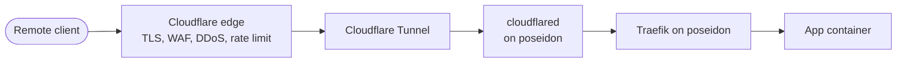

# cloudflare

Last verified: 2026-11-05

Cloudflare is the lab's front door. It is the registrar and DNS host for my
domain, runs the edge that remote users connect to, and carries traffic to
poseidon through a Cloudflare Tunnel. The tunnel's connector, cloudflared,
runs on poseidon. Its configuration lives in Cloudflare and is described
here.

Audit write-ups for Cloudflare are in [findings/cloudflare.md](../findings/cloudflare.md).

## Account and domain

| Item | Value |
|---|---|
| Account | One account, one member, two-factor sign-in on |
| Plan | Free |
| Zones | One |
| Registrar | Cloudflare Registrar. Auto-renew, transfer lock and WHOIS privacy on |
| Nameservers | Cloudflare (full setup, authoritative) |
| DNSSEC | On, with the DS record published. Registrar and DNS host are the same, so the DS record is managed in one place |

## Request path

- Each published app has its own public hostname in the tunnel, which also
  creates its proxied CNAME record. There is no wildcard, so a hostname that
  isn't listed doesn't resolve ([decision 0013](../decisions/0013-explicit-tunnel-hostnames.md)).
- The tunnel is remotely managed: its ingress rules are kept in Cloudflare,
  and cloudflared fetches them. It sends app traffic to Traefik on poseidon,
  which routes each request to a container by hostname. Anything that
  matches no rule gets a 404.
- cloudflared opens its connections outbound, so the home network has no
  port forwards (see [systems/network.md](network.md)).
- WARP private network routing is off. The tunnel carries web traffic only.

## DNS

- Every record is proxied. There are no DNS-only records, so the home WAN
  address is never published, and no record points at a private address.
- The domain sends and receives no mail, and its records say so:

| Record | Value |
|---|---|
| MX | `0 .` (null MX, RFC 7505) |
| SPF | `v=spf1 -all` |
| DMARC | `p=reject` for the domain and subdomains, strict alignment |
| CAA | Let's Encrypt, Google Trust Services, Sectigo, SSL.com |

Let's Encrypt is in the CAA set because the LAN DNS resolver gets its
certificate there (see [systems/adguard.md](adguard.md#encrypted-dns)). The
others are the CAs Cloudflare uses for edge certificates. Cloudflare adds
its own CAA entries for its CAs when it answers.

## Access

No Cloudflare Access applications are in use. The DNS admin UI used to sit
behind Access, and it is no longer published at all. The published apps are
for family use and keep their own logins. If an admin UI ever needs to be
reachable from outside, it goes behind Access first
([decision 0006](../decisions/0006-cloudflare-access.md)).

## TLS at the edge

| Setting | Value |
|---|---|
| Encryption mode | Full (strict) |
| Minimum TLS version | 1.2, with TLS 1.3 on |
| Always Use HTTPS | On |
| HSTS | On, 180 days, including subdomains, preload |
| Edge certificates | Issued and renewed automatically by Cloudflare, with a backup certificate from a second CA |

Traefik on poseidon serves a Cloudflare Origin CA certificate for the leg
from the tunnel to the origin.

## Edge protection

| Item | State |
|---|---|
| Managed WAF | Cloudflare Managed Free Ruleset and the Normalization ruleset |
| DDoS | Cloudflare's managed L7 DDoS ruleset, plus Advanced DDoS |
| Browser integrity check | On |
| AI bots | Blocked at the edge. A test request with an AI crawler's user agent got a 403 from Cloudflare and never reached Traefik |
| Rate limiting | One rule on the apps' login paths. An address that sends too many login requests in a short window is blocked for a short time |
| Caching | Off for the media server's hostname, so video passes through rather than being cached |

Behind the edge, CrowdSec on poseidon bans abusive addresses, and Traefik
enforces those bans (see [systems/poseidon.md](poseidon.md)).

## Alerts

A notification policy emails me when the tunnel's health is degraded or
down. I tested the emergency shut-off on 2026-11-05: stopping cloudflared
took every published app offline within seconds, and starting it brought them
back. The steps are in [runbooks/emergency-shutoff.md](../runbooks/emergency-shutoff.md).

## Documentation access

The audit used an API token created from the read-only template. It is
user-owned and does not expire, so later re-checks can run without
re-creating it.
