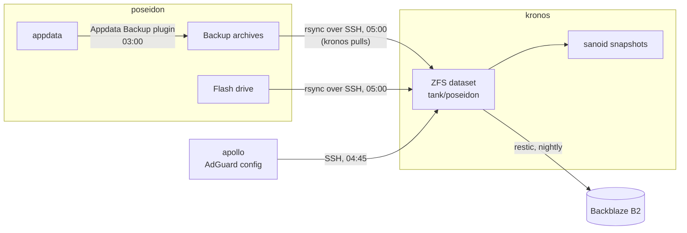

# kronos

Last verified: 2026-11-05

kronos is the lab's backup host. Every night it pulls poseidon's container
backups and a copy of poseidon's flash drive, keeps a history of them in ZFS
snapshots, and sends an encrypted copy offsite to Backblaze B2. It also keeps
a nightly copy of the primary DNS resolver's config. I built it in October
2026, and this doc describes how it is designed and set up.

Audit write-ups for kronos are in [findings/kronos.md](../findings/kronos.md).

## Hardware and OS

| Item | Value |
|---|---|
| Machine | Lenovo ThinkCentre M93p (small desktop) |
| CPU | Intel Core i5-4590T, 4 cores |
| RAM | 8 GB DDR3 |
| Boot disk | 256 GB SATA SSD, ext4 |
| Backup pool | 2 x 1 TB SATA SSD in a two-bay USB enclosure, ZFS mirror |
| Network | 1 GbE, 10.0.20.15 on the Services LAN |
| OS | Debian 13, minimal install with only SSH and standard utilities |
| Software | OpenZFS, sanoid, restic, rsync, smartmontools, all from the Debian repositories |

The host runs nothing but the backup jobs. Only SSH listens, there is no web
UI, SSH accepts keys only, and root cannot log in over SSH. root's password
is locked. unattended-upgrades applies Debian security and stable updates
daily, and the journal is persistent. Kernel updates need a manual reboot.

## Three copies

| Copy | Where | History |
|---|---|---|
| 1 | Backup archives on poseidon's array | 3 days, at least 3 runs |
| 2 | ZFS mirror on kronos | 14 daily, 8 weekly, 6 monthly snapshots |
| 3 | restic repository in Backblaze B2 | 7 daily, 4 weekly, 6 monthly snapshots |

The three copies are on two machines at home and one offsite, on
different kinds of storage (the Unraid array, a ZFS mirror, object storage).

## The nightly job

A systemd timer starts the backup job at 05:00. `Persistent=true` means a run
missed while kronos was off happens at the next boot.

0. **Check the pool.** The job stops with an error unless the backup dataset
   is mounted. Without this, a missing pool would have let the job write to
   the boot disk and report success.
1. **Pull appdata.** rsync over SSH copies poseidon's backup archive folder
   into the ZFS dataset, mirroring it with `--delete`. The archives are made
   at 03:00 by poseidon's Appdata Backup plugin, which stops each container
   while it archives it (see [systems/poseidon.md](poseidon.md#backups)).
2. **Pull the flash drive.** rsync copies the whole of poseidon's flash
   drive, which holds Unraid's configuration and license. The flash is FAT,
   which stores times in 2-second steps, so the pull uses `--modify-window=1`
   to avoid recopying unchanged files.
3. **Offsite.** restic backs up the dataset to B2, then applies its retention
   policy and prunes.
4. **Heartbeat.** The last step pings Uptime Kuma on poseidon, which alerts if
   a night's ping doesn't arrive.

A separate timer at 04:45 pulls the primary DNS resolver's config from apollo
into the same dataset, so it rides along in the snapshots and the B2 copy.
On apollo, that key can only run one export command.

The copy on kronos is a mirror of what poseidon holds that night. History
comes from the ZFS snapshots and from restic, not from the copy itself.

The script runs with `set -euo pipefail`, so any failed step fails the whole
run.

### Pull model

poseidon does not push. kronos holds the SSH key and starts every
connection, and poseidon has no credential for kronos at all. Someone who
takes over poseidon therefore cannot reach the backups to delete or encrypt
them. They could stop producing new backups or feed in bad ones, and the
mirror on kronos would follow, but the snapshots and the restic history keep
the earlier state.

On poseidon, the pull key is accepted only from kronos's address, with
forwarding and terminals turned off, and is tied to a forced command for the
pull. The forced command allows only the two exact rsync commands the job
uses, so the key can't be used to run anything else, even another rsync.

## Storage

| Item | Value |
|---|---|
| Pool | One mirror of two SSDs, referenced by stable device IDs |
| Pool settings | ashift 12 (4K sectors), zstd compression, atime off |
| Datasets | `tank/poseidon` for the poseidon copy |
| Snapshots | sanoid, checked every 15 minutes, takes and prunes snapshots of `tank/poseidon` |
| Scrub | Monthly |

Most of the data is already gzip-compressed archives, so zstd gains little on
them. It costs little and helps on the flash copy.

## Offsite: restic and Backblaze B2

- restic encrypts and deduplicates on kronos before anything leaves, so B2
  only ever holds encrypted data.
- restic talks to B2 through B2's S3-compatible API, with its cache on
  kronos so nightly runs stay quick.
- B2 keeps files that restic prunes as hidden versions for 30 days before
  deleting them.
- The repository password and the B2 credentials are kept in root-only
  files. The B2 credentials were entered at a prompt, so they never appear in
  shell history.

## Monitoring

Alerts go to Discord:

| Alert | Source |
|---|---|
| Backup job failure | A systemd `OnFailure` handler on the backup service |
| Pool and disk faults, scrub results | ZFS's event daemon (ZED) |
| SMART problems | smartd, which also runs a short self-test on every disk daily and a long one weekly. The pool disks are marked removable, so a powered-off enclosure doesn't stop it |
| Snapshots stale or pool unhealthy | sanoid's monitor checks, daily at 07:07, off the minute sanoid itself runs |
| No run at all | Uptime Kuma, if the nightly heartbeat doesn't arrive |

Alert delivery retries three times. Uptime Kuma runs on poseidon, so it is
silent when poseidon, the power or the internet is down, which I accepted.

## Restores tested

On 2026-11-04 I tested every layer:

- Extracted an app's archive from a ZFS snapshot and ran an integrity check
  on its database.
- Restored a file from B2 with restic and compared checksums with the local
  copy.
- Read a 10% sample of the B2 repository with `restic check`.
- Forced a job failure and got the Discord alert.
- Restored an app from a snapshot into a temporary container and compared
  its data with the live app.

The primary DNS resolver's config was restored the same way on 2026-11-05.

## After a power loss

The USB enclosure does not power back on by itself. After an outage I power
it on, import the pool by hand, and restart smartd. The job's pool check means
a night without the pool fails loudly instead of backing up the wrong disk.
