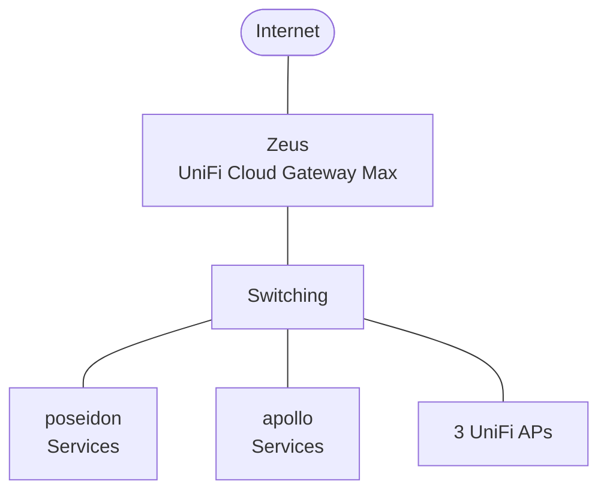

# network

Last verified: 2026-11-05

The network is a UniFi stack: a Cloud Gateway Max as gateway and firewall, a
24-port PoE switch and three Wi-Fi access points, all managed from the
gateway's built-in Network application as one site.

Audit write-ups for the network are in [findings/network.md](../findings/network.md).

## Hardware

| Device | Name | Model | Role |
|---|---|---|---|
| Gateway | Zeus | UniFi Cloud Gateway Max | Routing, firewall, DHCP, IPS, VPN, UniFi controller |
| Switch | Office Switch | UniFi US-24-250W (24 port, 250 W PoE) | Core switch |
| Access points | 3 APs | UniFi AC Pro | Wi-Fi |

The UniFi devices have static addresses on the Management network.

## Topology

- Every active link runs at 1 Gbps.
- Switch ports default to Management untagged with every other VLAN tagged.
  The ports for servers are overridden to use Services as their native
  network, so the servers need no VLAN config of their own.

## Networks

| Network | VLAN | Subnet | DHCP pool | Purpose |
|---|---|---|---|---|
| Management | untagged | 10.0.1.0/24 | 10.0.1.100 to 10.0.1.200 | UniFi devices and other network gear |
| Trusted | 10 | 10.0.10.0/24 | 10.0.10.100 to 10.0.10.200 | Household clients |
| Services | 20 | 10.0.20.0/24 | 10.0.20.100 to 10.0.20.200 | Servers: poseidon (10.0.20.10), apollo (10.0.20.5), artemis (10.0.20.6), kronos (10.0.20.15) |
| IoT | 30 | 10.0.30.0/24 | 10.0.30.100 to 10.0.30.200 | Smart-home devices |
| Guest | 40 | 10.0.40.0/24 | 10.0.40.100 to 10.0.40.200 | Guest Wi-Fi |

- Fixed addresses sit outside the DHCP pools.
- DHCP on every network hands out the two AdGuard Home resolvers, apollo and
  artemis, and no public resolver. Filtering therefore applies to every
  client that uses DHCP DNS. The resolvers are described in
  [systems/adguard.md](adguard.md).
- Every network hands out `lan` as its domain, matching the resolvers' local
  names. The gateway answers reverse lookups for its DHCP clients, so the
  resolvers can name devices.
- The guest SSID maps to the Guest network and has client isolation on.
- mDNS is on, so devices can be discovered on the LAN.
- The switches have DHCP snooping on, and DHCP guard is on for every network,
  trusting only the gateway, so a rogue DHCP server's offers are dropped.

## Firewall

The gateway uses UniFi's zone-based firewall.

| Zone | Contains |
|---|---|
| Internal | Management, Trusted, Services, IoT |
| Hotspot | Guest |
| External | The internet connection |
| Gateway | The gateway itself |
| Vpn | Remote access VPN clients |

### From the internet

- No port forwards, and UPnP and NAT-PMP are off.
- From the internet, the firewall allows only return traffic, plus the IPv6
  control messages the gateway needs. Nothing on the LAN or the gateway
  accepts a new connection from outside.
- Geo-IP filtering blocks inbound traffic from 10 countries.
- The only way in to a service is the Cloudflare Tunnel, which poseidon opens
  outbound (see [systems/poseidon.md](poseidon.md)).

### Inside

- Guest clients can reach the internet and DNS, and are otherwise kept off
  the internal networks.
- IoT has UniFi's network isolation turned on, which blocks it from starting
  connections to the other internal networks and to Guest.
- VPN clients can reach every zone. This is on purpose: the VPN is how I
  troubleshoot from outside, and only my own account can use it (reported by
  me, since the read-only audit account cannot list VPN users).

### Threat protection

- Intrusion prevention runs in IPS mode (detect and block) on all five
  networks, with 33 rule categories enabled. These include botnet
  command-and-control, known compromised and malicious hosts, and Tor.
- IPS honeypots listen on an address in each internal network.

## Remote access

- UniFi's Teleport VPN is the remote access VPN.
- The console's web UI is not reachable from the internet.
- SSH on the console is off. SSH on the switch and APs accepts keys only
  (reported by me, since the read-only audit account cannot see it).

## Internet connection

- One WAN connection, addressed by DHCP from the ISP.
- Smart Queues are on, to keep latency down when the upload is saturated.

## Updates

The console firmware and every UniFi device update themselves automatically
each night at 03:00, from the release channel.
