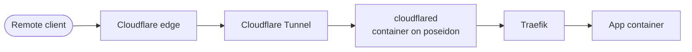

# poseidon

Last verified: 2026-11-05

poseidon is the main server. It runs Unraid and holds the media and book
libraries, the apps that manage them, the reverse proxy and Cloudflare Tunnel
that publish a few of them, and the second of the lab's two DNS resolvers.

Audit write-ups for this server are in [findings/poseidon.md](../findings/poseidon.md).

## Hardware

| Item | Value |
|---|---|
| CPU | Intel Core i7-4790K, 4 cores / 8 threads, 4.0 GHz |
| RAM | 16 GB DDR3 (2 x 8 GB) |
| Motherboard | ASUS Z97-A |
| GPU | NVIDIA Quadro P2000, 5 GB. Passed through to Jellyfin and Tunarr |
| Network | Intel I218-V onboard, 1 GbE |
| Boot | USB flash drive (Unraid boots from flash) |
| OS | Unraid |

## Storage

### Array

| Slot | Size | Model | Filesystem |
|---|---|---|---|
| Parity | 10 TB | HGST Ultrastar HUH721010ALE600 | none |
| Parity 2 | 10 TB | Seagate IronWolf ST10000VN0004 | none |
| Disk 1 | 10 TB | HGST Ultrastar HUH721010ALE600 | xfs |
| Disk 2 | 10 TB | HGST Ultrastar HUH721010ALE600 | xfs |

- Dual parity, so any two disks can fail without data loss.
- A non-correcting parity check runs on the first Sunday of each month. The
  most recent full check of both parity disks completed on 2026-10-20 with
  0 errors.
- Disks spin down after 30 minutes idle.

### Cache pool

| Device | Size | Type |
|---|---|---|
| cache | 1 TB | NVMe SSD |
| cache2 | 1 TB | SATA SSD |

The pool is btrfs with the raid1 profile, so the two SSDs mirror each other.
It holds `appdata` (container config and databases), the Docker image and the
`system` share. The mover runs daily at 04:00.

### Media layout

Media and downloads share one user share, mounted into containers as `/data`:

```
/data
  media/         finished libraries: movies, tv, books, comics, and more
  usenet/        usenet client output, by category
  books-ingest/  book downloads waiting to be imported
  recycle-bin/   files the TV and movie managers delete, kept for 7 days
```

NZBGet, Sonarr, Radarr and Bazarr all mount the same tree at the same path, so
the TV and movie managers import finished downloads with a move on the same
filesystem, not a copy. Downloads come from usenet only.

Jellyfin mounts only `media/`. Pullbox, the comics manager, mounts only the
comics library and its own download folder, at the same paths it would see
under the full tree.

## Containers

Containers run under Unraid's Docker manager, from a vDisk image on the cache
pool. Container logs rotate at 10 MB.

| Role | Containers |
|---|---|
| Edge | cloudflared (Cloudflare Tunnel), Traefik, CrowdSec, Docker socket proxy |
| Media servers | Jellyfin, Tunarr, Komga, Calibre-Web Automated |
| Library management | Sonarr, Radarr, Bazarr, Prowlarr, Pullbox, Shelfmark, FlareSolverr |
| Requests | Seerr |
| Downloads | NZBGet, MeTube |
| DNS | AdGuard Home (artemis), adguardhome-sync |
| Monitoring | Uptime Kuma |

Jellyfin and Tunarr have access to the GPU.

Every container has the restart policy `unless-stopped`, set in its template
so it survives updates, and Unraid starts them from its autostart list after
a boot.

Most containers sit on one user-defined bridge network, which Traefik also
uses to reach them. The AdGuard Home container is the exception (see below).

Traefik finds its routes from container labels. It reads them through a
socket proxy, not the Docker socket. The proxy runs unprivileged and
read-only, publishes no ports, and answers only Traefik, and only for the read
requests Traefik's Docker provider makes. Traefik's image is pinned to its
major version. The other images follow their latest release, and the nightly
backups are the rollback.

## Network

| Item | Value |
|---|---|
| Address | 10.0.20.10 on the Services LAN (10.0.20.0/24), from a DHCP reservation on the gateway |
| Gateway | 10.0.20.1 |
| Time | NTP enabled, synced to pool.ntp.org. Time zone matches the site |
| Unraid webGUI and SSH | Bound to the LAN address only. SSH accepts keys only. Telnet is off |
| UPnP | Off |

The gateway has no port forwards to poseidon. Remote access works only
through the Cloudflare Tunnel.

### Remote access through the tunnel



- cloudflared opens the tunnel outbound to Cloudflare, so nothing listens for
  inbound connections from the internet.
- Traefik is the only thing cloudflared sends traffic to. Traefik routes each
  request to a container by hostname.
- Traefik serves HTTPS with a Cloudflare Origin CA certificate and redirects
  HTTP to HTTPS.
- A container is published only when it is explicitly configured with a
  Traefik route. Nothing is exposed by default.
- A small number of user-facing apps are published this way, each with its
  own route in the tunnel and its own DNS record. There is no wildcard, so a
  new Traefik route stays private until I add it to the tunnel. The tunnel
  side is in [systems/cloudflare.md](cloudflare.md).
- Traefik trusts forwarded client addresses only from the tunnel's network,
  so it sees each visitor's real address. CrowdSec reads Traefik's access log,
  and its plugin inside Traefik blocks any address CrowdSec has banned, on
  every published app.

### Second DNS resolver: artemis

artemis is an AdGuard Home container on poseidon. It is a replica of the
primary AdGuard Home on apollo, a Raspberry Pi at 10.0.20.5.

- It runs on a macvlan network with its own LAN address, 10.0.20.6, so
  clients reach it as a separate host on the Services LAN.
- An adguardhome-sync container copies apollo's configuration to artemis
  every 15 minutes, so both resolvers filter and answer the same way.
- DHCP on every LAN hands out both apollo and artemis, so clients have a
  second filtered resolver if one is down.

## Monitoring

Unraid's own notifications at warning and alert level go to Discord, as well
as to the webGUI.

Scheduled user scripts add checks of their own and post to Discord:

| Script | Runs |
|---|---|
| array-health-monitor | every 5 min |
| container-health-monitor | every 5 min |
| dns-health-monitor | every 5 min |
| disk-temperature-monitor | every 10 min |
| system-resource-monitor | every 15 min |

array-health-monitor reads the array state and the counts of disabled,
invalid and missing disks, plus each disk's status and error count.
dns-health-monitor checks both AdGuard resolvers and the sync container.

array-health-monitor and dns-health-monitor keep state, so a problem posts
one alert instead of one every run. They record an alert as sent only after
Discord accepts it. dns-health-monitor also posts when a problem clears. In a
test on 2026-10-20, stopping artemis produced a critical alert, and starting
it again produced the "resolved" message.

Uptime Kuma, also on poseidon, expects a heartbeat from kronos at the end of
each successful nightly backup, and alerts if one doesn't arrive. That covers
the failures that make no noise, like kronos being off.

## Backups

The Appdata Backup plugin backs up container config and databases every day
at 03:00. It stops each container in turn, archives its appdata folder,
verifies the archive and starts the container again, so databases are copied
while nothing is writing to them. Runs older than 3 days are deleted, and at
least 3 are always kept.

kronos, a separate backup host on the Services LAN, pulls those archives and
the whole flash drive every night at 05:00 over SSH, with a dedicated key that
is accepted only from kronos's address. kronos keeps its own snapshot history
and an offsite copy, described in [systems/kronos.md](kronos.md). A restore of
an app from those copies into a temporary container has been tested.

## VMs

The Unraid VM manager is disabled. No VMs run on poseidon.
